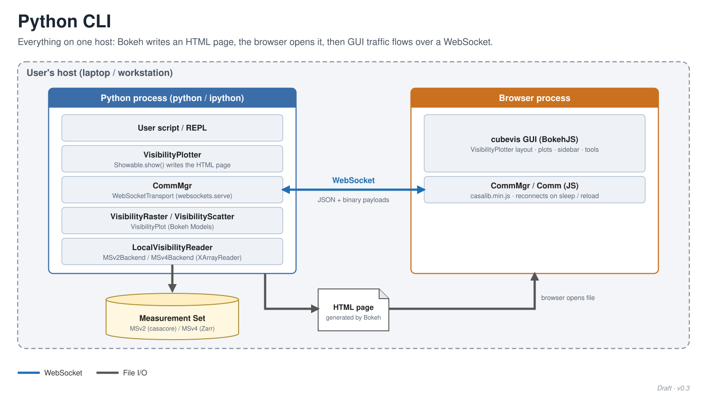
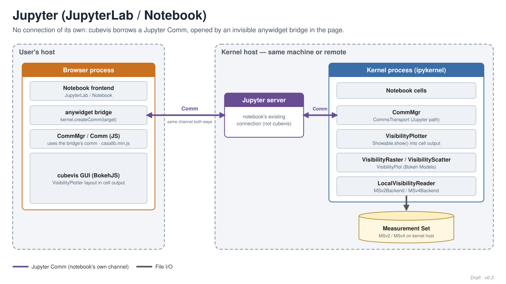
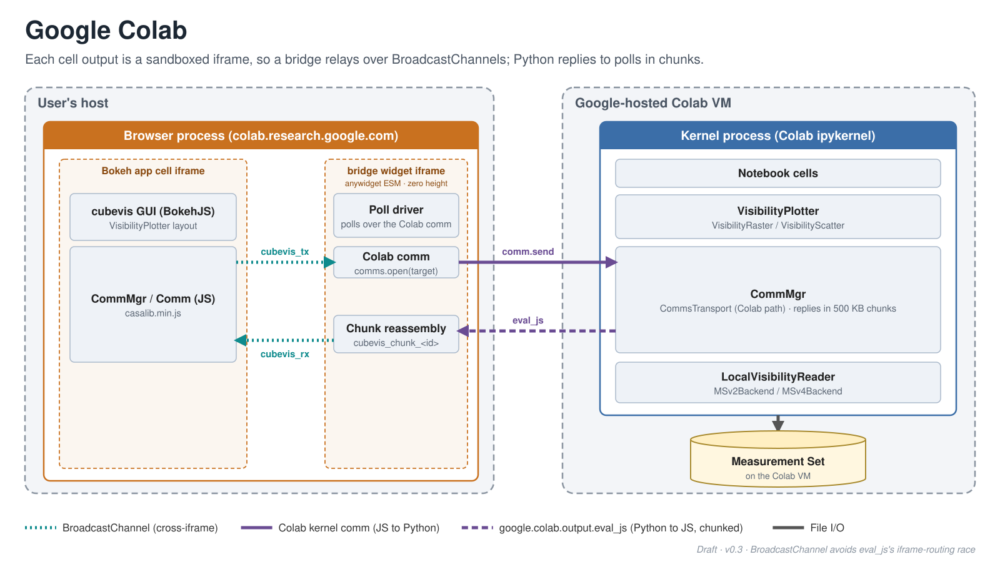
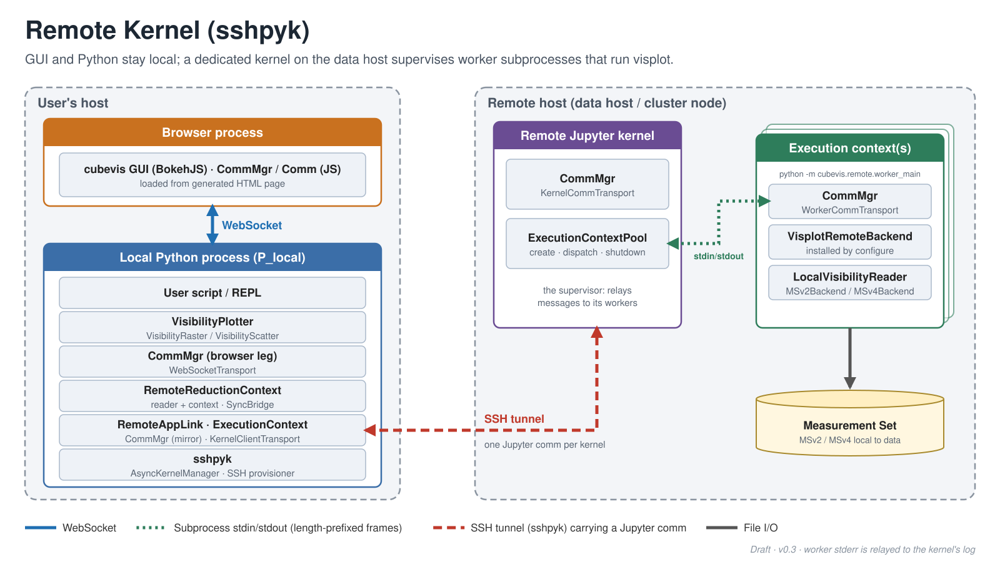

# cubevis architectures

How hosts, processes and communication channels connect in each mode
`cubevis` supports. Every slide uses the same visual vocabulary:

- **Dashed region**: a host
- **Box with a coloured header**: a process (blue Python, orange browser,
  purple Jupyter, green execution context)
- **Grey block**: a component inside that process, named by its class
- **Arrow**: a channel; its colour and dash identify the protocol, listed
  in the legend at the bottom of each slide

## Regenerating

The SVGs are generated; edit `make_diagrams.py`, not the SVGs.

```sh
python make_diagrams.py               # rewrite the SVGs next to the script
python make_diagrams.py --png         # also write 3200x1800 PNGs for slides
python make_diagrams.py --png --scale 3
```

PNG output needs `cairosvg` (`pip install cairosvg`). PNGs are ignored by
git; generate them when you need to drop a slide into Google Slides, which
does not import SVG.

## Python CLI

Everything runs on one host. Bokeh writes an HTML page, the browser opens
it, and GUI traffic then flows over a WebSocket served by `CommMgr`.



## Jupyter (JupyterLab / Notebook)

cubevis opens no connection of its own. An invisible anywidget bridge
creates a Jupyter Comm, which carries traffic in both directions through
the notebook's existing server connection.



## Google Colab

Each cell output is a sandboxed iframe, so the bridge widget relays
messages to the Bokeh app iframe over BroadcastChannels. The bridge polls
while the GUI awaits a reply, and Python answers each poll with chunked
`eval_js` calls.



## Remote Kernel (sshpyk)

The GUI and the user's Python stay local. sshpyk starts a dedicated
Jupyter kernel on the data host; that kernel supervises one worker
subprocess per execution context, connected over stdin/stdout, and the
workers run the visplot backend next to the data.


