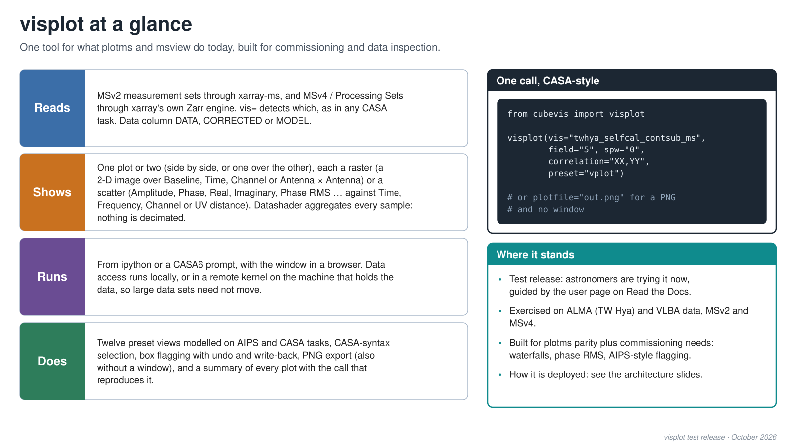
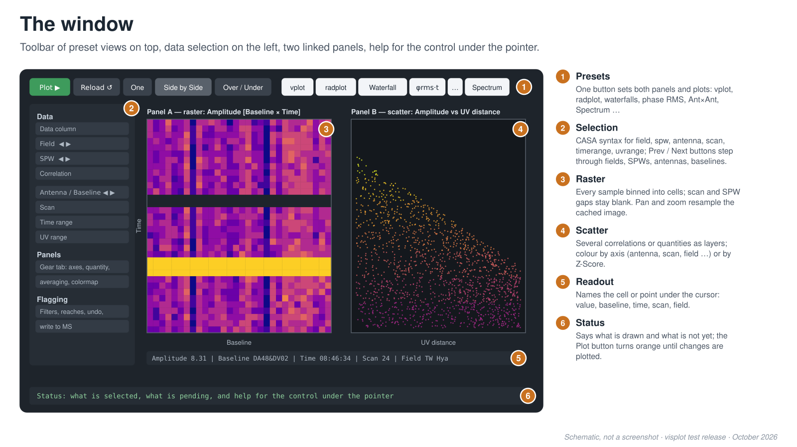
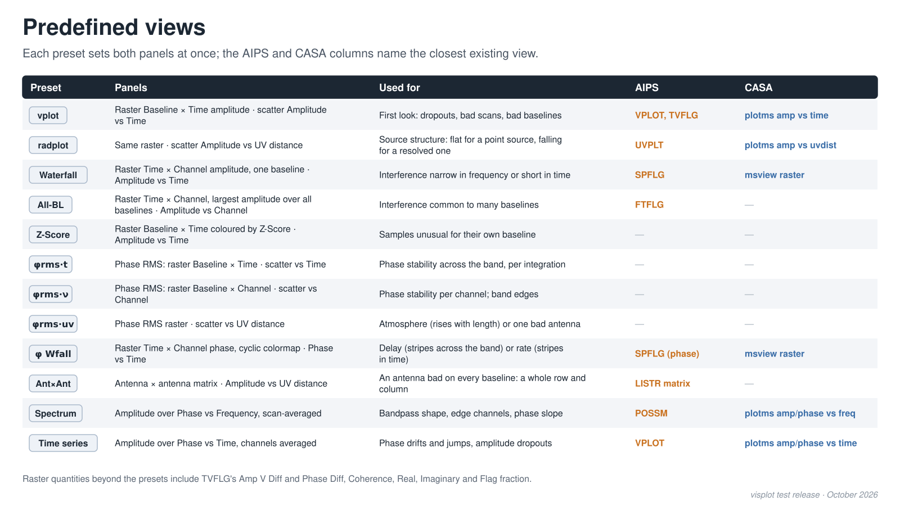
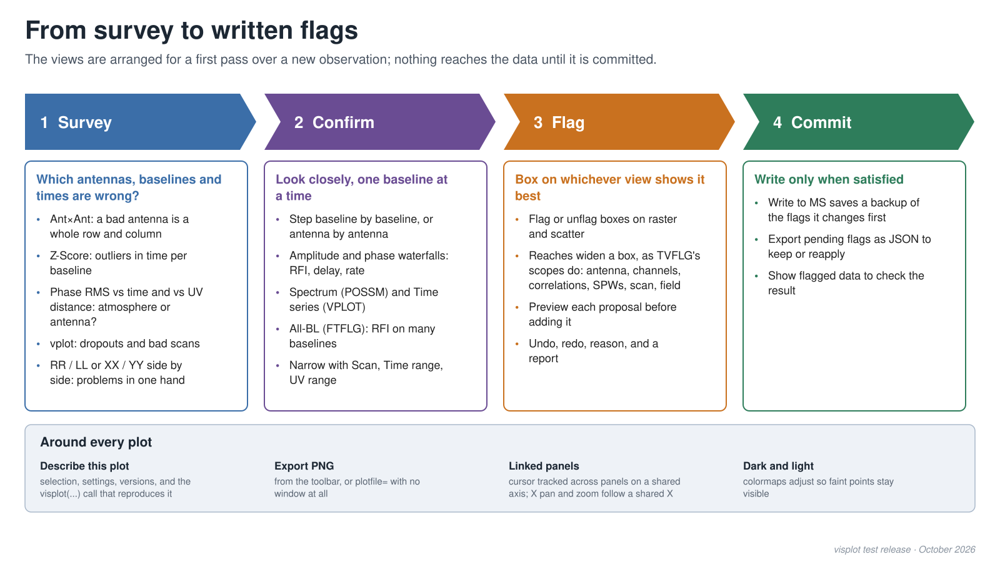
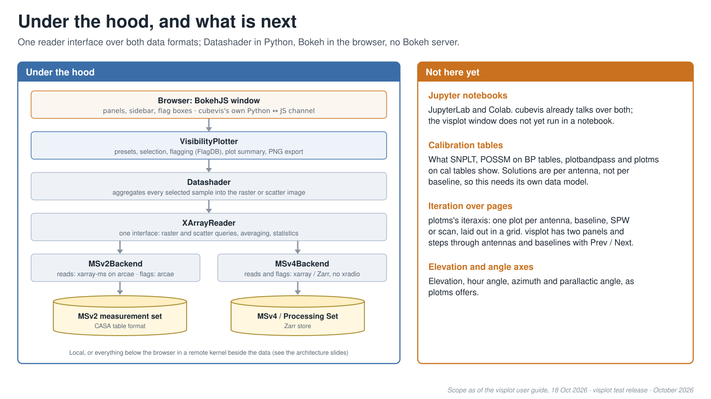

# visplot overview

**[▶ View as a slideshow](https://casangi.github.io/cubevis/visplot/slides.html)**
(arrow keys or click to step, **F** for fullscreen)

What `visplot` does today, for readers who know plotms, msview or AIPS:
what it reads and where it runs, the window, the preset views and their
AIPS/CASA counterparts, the survey-to-flags workflow, and what sits under the hood, with the
features users will ask for that are not here yet. Same visual style as `../architecture`.

The scope follows the "Scope, explicitly" section of the visplot user
guide (`docs/source/applications/visplot.rst`); update both together.

## Regenerating

The SVGs are generated; edit `make_slides.py`, not the SVGs.

```sh
python make_slides.py               # rewrite the SVGs and slides.html
python make_slides.py --png         # also write 3200x1800 PNGs for Google Slides
```

PNG output needs `cairosvg`. PNGs are ignored by git.

## Adding screenshots

Slide 2 is a schematic of the window, not a screenshot. To add real
screenshots, put the PNGs in this folder and list each in `EXTRA_IMAGES`
at the top of `make_slides.py`, naming the slide it should follow; the
slideshow shows PNGs as readily as SVGs. A preset can be captured without
a window with `visplot(vis=..., preset="spectrum", plotfile="spectrum.png")`.

## Slides






